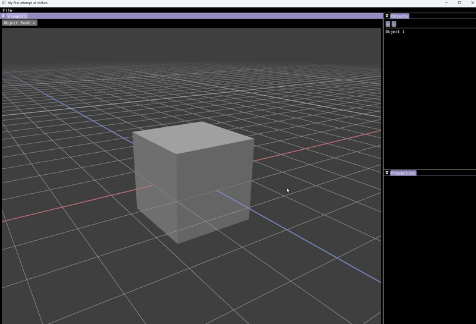

# 3D Modeling DCC

## Project Background

This is a personal project of mine that started out as a basic vulkan-tutorial.com renderer. 
My initial idea was to pivot this into a Game Engine but after I started reading "Game Engine Architecture" by Jason Gregory i felt like it was a bit too big in scope for my first Vulkan project.

So i ended up going with a 3D DCC similar to Blender so i could spend more time on each area of expertise, ie. 3D Models, Material System or Texturing. With a DCC these are all isolated parts i can work on individually while still seeing results. Instead of having to shoulder everything before i see satisfying results (like a game)

## Current Functionality

##### Here's a GIF to show how the program looks like visually when you run it

### As you can see its still a work in progress. The mesh editing functions are still pretty limited but here is a summary of the current features:
- Working Viewport and resizable and dockable UI
- Orbital Camera
- Procedural Grid shader (not a textured quad)
- Object // Edit mode switch
- Spawning cubes
- Importing .obj (wavefront) files
- Object and Vertex selection (and outline shader in Object Mode)
- Moving Objects and Vertices parallel to the view/camera
- Smooth and flat shading switch

## Future of the Project

### I want to continue to work on this as a portfolio project in the near Future and all the way through University to add things such as:
- more mesh editing functions
- undo/redo (with command-pattern)
- Modifiers
- A Node-based Material System
- Texturing and UV-editing
- maybe even a rigging and animation editor in the future
