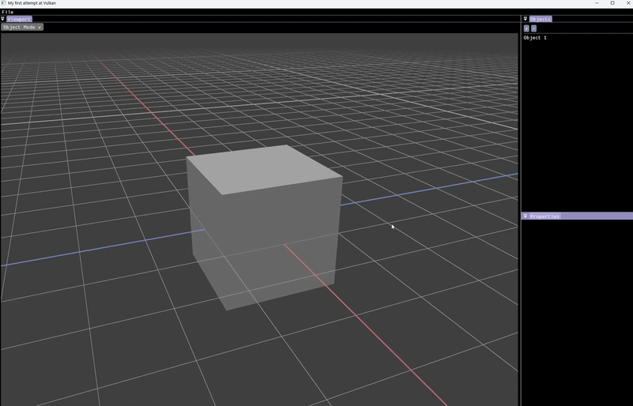

# 3D Modeling DCC

#### This is a personal project of mine that started out as a basic vulkan-tutorial.com renderer. 
#### My initial idea was to pivot this into a Game Engine but after I started reading "Game Engine Architecture" by Jason Gregory i felt like it was a bit too big in scope for my first Vulkan project.

#### So i ended up going with a 3D DCC similar to Blender so i could spend more time on each area of expertise, ie. 3D Models, Material System or Texturing. With a DCC these are all isolated parts i can work on individually while still seeing results. Instead of having to shoulder everything before i see satisfying results (like a game)

## Current Functionality

#### As seen in the image below, It has a working

